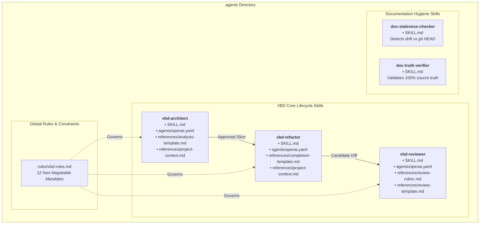
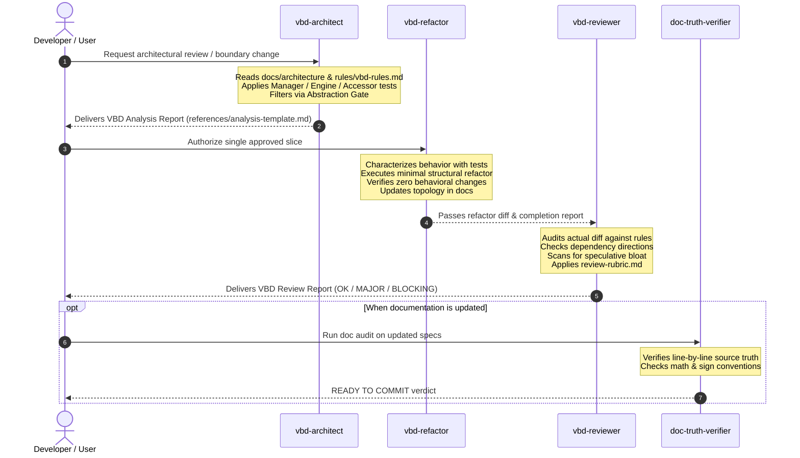

# `.agents` Architecture and Volatility-Based Decomposition (VBD) Skills Report

## 1. Executive Summary

The [`.agents`](file:///Users/west/programming_stuff/budget_app/.agents) directory defines repository-local intelligence configurations, behavioral constraints, and specialized automation skills for AI coding agents operating within this repository. 

Its primary purpose is to operationalize and enforce **Volatility-Based Decomposition (VBD)**—an architectural methodology adapted from Juval Löwy’s *Righting Software*. Under VBD, software architecture is organized around demonstrated axes of volatility rather than functional nouns, database tables, or HTTP endpoints.

The directory houses two main subtrees:
1. **[`.agents/rules/`](file:///Users/west/programming_stuff/budget_app/.agents/rules)**: Project-level governing constraints and non-negotiable architectural mandates.
2. **[`.agents/skills/`](file:///Users/west/programming_stuff/budget_app/.agents/skills)**: Self-contained skill modules containing execution instructions ([`SKILL.md`](file:///Users/west/programming_stuff/budget_app/.agents/skills/vbd-architect/SKILL.md)), metadata definitions ([`agents/openai.yaml`](file:///Users/west/programming_stuff/budget_app/.agents/skills/vbd-architect/agents/openai.yaml)), and structured report templates or contextual fallbacks ([`references/`](file:///Users/west/programming_stuff/budget_app/.agents/skills/vbd-architect/references)).

The VBD skillset defines a strict, 3-phase lifecycle:
$$\text{Pre-analysis } (\texttt{vbd-architect}) \longrightarrow \text{Implementation } (\texttt{vbd-refactor}) \longrightarrow \text{Post-review } (\texttt{vbd-reviewer})$$

Supplementary documentation skills ([`doc-staleness-checker`](file:///Users/west/programming_stuff/budget_app/.agents/skills/doc-staleness-checker) and [`doc-truth-verifier`](file:///Users/west/programming_stuff/budget_app/.agents/skills/doc-truth-verifier)) guarantee that architecture and API documentation remains 100% synchronized with the running codebase.

---

## 2. Directory Tree Structure

```text
.agents/
├── README.md
├── rules/
│   └── vbd-rules.md
└── skills/
    ├── doc-staleness-checker/
    │   └── SKILL.md
    ├── doc-truth-verifier/
    │   └── SKILL.md
    ├── vbd-architect/
    │   ├── SKILL.md
    │   ├── agents/
    │   │   └── openai.yaml
    │   └── references/
    │       ├── analysis-template.md
    │       └── project-context.md
    ├── vbd-refactor/
    │   ├── SKILL.md
    │   ├── agents/
    │   │   └── openai.yaml
    │   └── references/
    │       ├── completion-template.md
    │       └── project-context.md
    └── vbd-reviewer/
        ├── SKILL.md
        ├── agents/
        │   └── openai.yaml
        └── references/
            ├── review-rubric.md
            └── review-template.md
```

### Visual Architecture Diagram



---

## 3. In-Depth File-by-File Breakdown

### 3.1. Rules Subtree

#### [`.agents/rules/vbd-rules.md`](file:///Users/west/programming_stuff/budget_app/.agents/rules/vbd-rules.md)
* **File Type**: Markdown rule definition (35 lines, 2.4 KB)
* **Purpose**: Serves as the high-priority, root behavioral specification for any autonomous agent or human developer modifying the repository’s architecture.
* **Key Components & Content**:
  1. **Cross-References**: Points agents to corresponding skills ([`vbd-architect`](file:///Users/west/programming_stuff/budget_app/.agents/skills/vbd-architect/SKILL.md), [`vbd-refactor`](file:///Users/west/programming_stuff/budget_app/.agents/skills/vbd-refactor/SKILL.md), [`vbd-reviewer`](file:///Users/west/programming_stuff/budget_app/.agents/skills/vbd-reviewer/SKILL.md)), architectural context documents ([`docs/architecture/current-state.md`](file:///Users/west/programming_stuff/budget_app/docs/architecture/legacy/current-state.md), [`volatility-map.md`](file:///Users/west/programming_stuff/budget_app/docs/architecture/legacy/volatility-map.md), [`refactor-safety.md`](file:///Users/west/programming_stuff/budget_app/docs/architecture/refactor-safety.md)), and historical checkpoints ([`checkpoint 1`](file:///Users/west/programming_stuff/budget_app/docs/checkpoints/number_1.md)).
  2. **12 Non-Negotiable Rules**:
     - **Rule 1**: Base architecture strictly on observed or confirmed roadmap volatility; reject speculative future features.
     - **Rules 2–5 (Taxonomy)**: 
       - `Manager` = Meaningful workflow sequencing across multiple components.
       - `Engine` = Pure, independently volatile business algorithm/policy.
       - `Accessor/ResourceAccess` = Concrete database, external API, or filesystem operations.
       - `Presentation` = HTTP transport, validation, error mapping, and serialization.
     - **Rule 6**: Not every endpoint needs every layer (simple CRUD may go directly from Router to Accessor).
     - **Rule 7**: Domain nouns do not automatically warrant their own architectural components.
     - **Rule 8**: Prefer concrete functions and modules over abstract interfaces, generic repositories, or frameworks.
     - **Rule 9**: Characterize current behavior with tests before structural extraction.
     - **Rule 10**: Maintain single-slice discipline: *One volatility boundary $\rightarrow$ one refactor $\rightarrow$ full tests $\rightarrow$ review $\rightarrow$ commit*.
     - **Rule 11**: Do not bundle bug fixes, product decisions, security migrations, or general cleanup into refactors.
     - **Rule 12**: Halt execution immediately after the approved slice; do not auto-advance into subsequent tasks.

---

### 3.2. Core VBD Skill: `vbd-architect`

This skill handles pre-implementation analysis. It is strictly analytical and **forbidden from modifying production code**.

```text
.agents/skills/vbd-architect/
├── SKILL.md
├── agents/
│   └── openai.yaml
└── references/
    ├── analysis-template.md
    └── project-context.md
```

#### 1. [`SKILL.md`](file:///Users/west/programming_stuff/budget_app/.agents/skills/vbd-architect/SKILL.md)
* **File Type**: Agent skill instructions with YAML frontmatter (98 lines, 3.9 KB)
* **Metadata**:
  - `name`: `vbd-architect`
  - `description`: Analyze budget app using volatility-based decomposition before architecture or refactor work. Analysis only.
* **Core Sections**:
  - **Required Reading**: Requires checking canonical project architecture files (`AGENTS.md`, `vbd-charter.md`, `dependency-rules.md`, `volatility-registry.md`, `known-invariants.md`, `component-map.md`, `workflow-catalog.md`).
  - **10-Step Workflow**: Traces end-to-end source workflow, inventories inputs/outputs/dependencies, classifies change sources (`OBSERVED`, `PLANNED`, `SPECULATIVE`), applies layer boundary tests, rejects overengineering, and recommends exactly one vertical slice.
  - **Boundary Tests**:
    - *Manager Test*: Must coordinate multiple Accessors/Engines or own multi-step transactions; single-CRUD wrappers are rejected.
    - *Engine Test*: Must be pure business algorithms with zero dependencies on FastAPI, Pydantic transport schemas, SQLAlchemy ORM, database sessions, SDKs, or disk I/O.
    - *ResourceAccess Test*: Must contain concrete resource mechanics without hiding business sequencing or calling other Accessors.
  - **Abstraction Gate**: Triad filter that rejects interfaces, factories, strategies, and DTO layers unless they protect demonstrated independent volatility and reduce coupling more than added ceremony.

#### 2. [`agents/openai.yaml`](file:///Users/west/programming_stuff/budget_app/.agents/skills/vbd-architect/agents/openai.yaml)
* **File Type**: YAML UI configuration (4 lines, 148 bytes)
* **Contents**:
  ```yaml
  interface:
    display_name: "Budget VBD Architect"
    short_description: "Analyze budget-app architecture by observed volatility before refactoring."
  ```
* **Purpose**: Registers user-facing display properties for agent environments (such as OpenAI Assistant or CLI interfaces).

#### 3. [`references/analysis-template.md`](file:///Users/west/programming_stuff/budget_app/.agents/skills/vbd-architect/references/analysis-template.md)
* **File Type**: Markdown output template (48 lines, 676 bytes)
* **Purpose**: Provides a standardized template for architectural analysis reports.
* **Structure**:
  - `## Workflow`: Step-by-step sequence of current code execution.
  - `## Responsibilities and dependencies`: Markdown table mapping responsibility, current owner, I/O dependencies, and VBD layer classification.
  - `## Volatility evidence`: Table evaluating each responsibility against `OBSERVED`, `PLANNED`, or `SPECULATIVE` categories with concrete justification.
  - `## Boundary assessment`: Concrete analysis of Manager, Engine, ResourceAccess, Presentation, and `None` boundaries.
  - `## Dependency findings`: Explicit allowed vs. prohibited dependency paths.
  - `## Overengineering rejected`: Explicit list of speculative patterns turned down.
  - `## Behavior/invariants to preserve`: Preserved financial and business invariants.
  - `## Recommended next slice`: Definition of the single recommended structural slice and its expected dependency migration (`before -> after`).

#### 4. [`references/project-context.md`](file:///Users/west/programming_stuff/budget_app/.agents/skills/vbd-architect/references/project-context.md)
* **File Type**: Compact project architectural context (32 lines, 2.2 KB)
* **Purpose**: Serves as a fallback context document when full repository documentation is unavailable or inaccessible.
* **Key Content**:
  - **Canonical Flow**: `Presentation/FastAPI -> meaningful Manager -> Engine and/or ResourceAccess -> Resource` (simple CRUD can bypass Manager directly to ResourceAccess).
  - **Observed Engine Areas**: Budgeting zero-sum math, credit card reconciliation, merchant normalization, ML categorization, transfer candidate matching, split validation.
  - **Observed Integration Volatility**: CSV formats/headers, Plaid SDK cursor sync, PostgreSQL aggregations.
  - **Current System Status**: Modernization complete; previous structural hotspots (Plaid token exchange, CSV upload sequencing, transaction cross-access) are resolved. Prefer zero architectural churn without new observed volatility.
  - **Hardened Invariants**: `Transaction.description` is `TEXT NOT NULL` (empty string denotes missing), category groups cannot be deleted if non-empty, Plaid tokens use `enc:v1:` Fernet encryption, credit card calculations use point-in-time cutoffs.
  - **Explicitly Rejected Speculative Items**: Alternative DB engines (e.g. SQLite/MySQL), hypothetical multi-bank abstractions, multi-currency, GraphQL/gRPC, generic rule DSLs, multi-tenant auth.

---

### 3.3. Core VBD Skill: `vbd-refactor`

This skill implements an approved architectural slice. It enforces minimal scope, strict behavior preservation, and automated verification.

```text
.agents/skills/vbd-refactor/
├── SKILL.md
├── agents/
│   └── openai.yaml
└── references/
    ├── completion-template.md
    └── project-context.md
```

#### 1. [`SKILL.md`](file:///Users/west/programming_stuff/budget_app/.agents/skills/vbd-refactor/SKILL.md)
* **File Type**: Agent skill instructions with YAML frontmatter (95 lines, 4.1 KB)
* **Metadata**:
  - `name`: `vbd-refactor`
  - `description`: Implement one evidence-approved VBD refactor slice in the budget app while preserving behavior. Requires tests, minimal scope, documentation updates, and no speculative abstractions.
* **Core Sections**:
  - **Preconditions**: Refactoring is blocked until current workflow, volatility evidence, responsibility classifications, target dependencies, invariants, and test coverage are documented. If only backed by `SPECULATIVE` volatility, execution must halt immediately.
  - **15-Step Refactor Workflow**:
    1. Inspect source and tests for the chosen workflow.
    2. Add characterization tests if current behavior is not fully pinned.
    3. Execute the minimal structural edit that resolves the boundary.
    4. Keep domain and accounting behavior identical.
    5. Maintain pure, infrastructure-free Engines.
    6. Ensure Managers own multi-step orchestration (not Routers or Accessors).
    7. Retain direct Router $\rightarrow$ Accessor paths for simple CRUD.
    8. Avoid DTO overengineering.
    9. Avoid generic repository or factory interfaces.
    10. Avoid unrelated cleanups, renamings, or schema edits.
    11. Run targeted unit tests continuously.
    12. Execute the full test suite (`python3 -m pytest` / `python3 tests/smoke_test.py`).
    13. Audit git diff statistics and line diffs.
    14. Update architecture documentation within the same commit.
    15. Hand the resulting diff directly to `vbd-reviewer`.
  - **Transaction Rule**: Managers are explicitly allowed to receive SQLAlchemy `Session` objects and manage `commit`/`rollback` across workflows.

#### 2. [`agents/openai.yaml`](file:///Users/west/programming_stuff/budget_app/.agents/skills/vbd-refactor/agents/openai.yaml)
* **File Type**: YAML UI configuration (4 lines, 141 bytes)
* **Contents**:
  ```yaml
  interface:
    display_name: "Budget VBD Refactor"
    short_description: "Implement one behavior-preserving VBD boundary correction at a time."
  ```

#### 3. [`references/completion-template.md`](file:///Users/west/programming_stuff/budget_app/.agents/skills/vbd-refactor/references/completion-template.md)
* **File Type**: Markdown handoff report template (47 lines, 336 bytes)
* **Purpose**: Standardized handoff report generated upon completion of a refactoring slice, intended for consumption by `vbd-reviewer`.
* **Report Sections**:
  - `## Architecture change`: Before vs. After sequence and topology.
  - `## Files changed`: Bulleted list of modified files.
  - `## Dependencies`: Removed vs. introduced imports/coupling.
  - `## Behavior changes`: Must state `NONE` unless explicitly authorized.
  - `## Tests`: Executed commands and exact test results.
  - `## Documentation updated`: Synchronized documentation files.
  - `## Known issues intentionally untouched`: Explicit record of out-of-scope defects not altered.
  - `## Reviewer attention`: Specific callouts for the post-refactor review agent.

#### 4. [`references/project-context.md`](file:///Users/west/programming_stuff/budget_app/.agents/skills/vbd-refactor/references/project-context.md)
* **File Type**: Compact project refactor context (29 lines, 1.7 KB)
* **Purpose**: Compact fallback context tailored for refactoring execution, enumerating stable boundaries, resolved hardening invariants, future candidate backlog items, and rejected speculative drivers.

---

### 3.4. Core VBD Skill: `vbd-reviewer`

This skill acts as the quality gatekeeper. It audits diffs against the VBD charter, flags architectural regressions, and prevents architectural overreach.

```text
.agents/skills/vbd-reviewer/
├── SKILL.md
├── agents/
│   └── openai.yaml
└── references/
    ├── review-rubric.md
    └── review-template.md
```

#### 1. [`SKILL.md`](file:///Users/west/programming_stuff/budget_app/.agents/skills/vbd-reviewer/SKILL.md)
* **File Type**: Agent skill instructions with YAML frontmatter (65 lines, 2.8 KB)
* **Metadata**:
  - `name`: `vbd-reviewer`
  - `description`: Review a budget-app architecture or refactor diff for compliance with VBD rules. Reviews diffs for boundary correctness, speculative abstractions, behavior preservation, and documentation drift.
* **Core Sections**:
  - **11-Step Review Workflow**: Restates intended change, inspects actual `git diff` and call graphs (never trusting self-reported summaries), verifies volatility evidence, checks dependency directions, evaluates behavioral and transaction preservation, inspects test outcomes, and assigns a severity rating.
  - **Explicit Violation Checklist (Blocking/Major)**:
    - Multi-step business workflow retained in Presentation (routers).
    - Accessor modules orchestrating other Accessor modules.
    - Business policies duplicated within persistence layer code.
    - Engine importing HTTP, ORM models, SQLAlchemy Sessions, external SDKs, or disk I/O.
    - Manager coupled to FastAPI transport objects (`Request`, `Response`, `HTTPException`).
    - Pass-through/CRUD Managers or micro-Engine wrappers around single utility functions.
    - Speculative generic patterns (Repository, Unit of Work, Provider, DTO layers).
    - Unintentional changes to financial math or accounting conventions.
    - Documentation claiming a topology divergent from the source code.
  - **Non-Violations Clarification**: Explicitly notes that Managers taking a SQLAlchemy `Session`, simple CRUD Routers calling Accessors directly, or small pure helpers not being elevated to Engines are **allowed and encouraged**.

#### 2. [`agents/openai.yaml`](file:///Users/west/programming_stuff/budget_app/.agents/skills/vbd-reviewer/agents/openai.yaml)
* **File Type**: YAML UI configuration (4 lines, 144 bytes)
* **Contents**:
  ```yaml
  interface:
    display_name: "Budget VBD Reviewer"
    short_description: "Review VBD refactor diffs for boundary correctness and behavior safety."
  ```

#### 3. [`references/review-rubric.md`](file:///Users/west/programming_stuff/budget_app/.agents/skills/vbd-reviewer/references/review-rubric.md)
* **File Type**: Scoring rubric (20 lines, 833 bytes)
* **Purpose**: Defines objective criteria for classifying review findings into 4 severity levels:
  - `BLOCKING`: Slice is unsafe to merge. Caused by behavior regressions, inverted architectural directions, speculative abstractions central to the PR, test failures, or undocumented schema/security modifications.
  - `MAJOR`: Slice mostly functions but introduces architectural debt (workflow left in router, Accessor-to-Accessor chaining, policy duplication, infrastructure leakage in Engines).
  - `MINOR`: Naming inconsistencies, documentation phrasing, or non-boundary cleanup opportunities.
  - `OK`: No material VBD, dependency, or behavioral issues found. Emphasizes *evidence over aesthetics*—lean concrete implementations are favored over excessive symmetry.

#### 4. [`references/review-template.md`](file:///Users/west/programming_stuff/budget_app/.agents/skills/vbd-reviewer/references/review-template.md)
* **File Type**: Review report template (34 lines, 401 bytes)
* **Structure**:
  - `## Slice reviewed`: Name/description of reviewed change.
  - `## Verdict`: High-level assessment (`OK / MINOR / MAJOR / BLOCKING`).
  - `## Findings`: Itemized findings with `[severity] Title`, concrete `Evidence`, violated `VBD rule`, and required `Correction`.
  - `## Dependency check`: Target dependency vs. actual post-refactor dependency.
  - `## Behavior/test check`: Regression analysis and test verification.
  - `## Documentation check`: Verification that architecture docs were updated in lockstep.
  - `## Speculative abstraction check`: Audits for unwarranted abstraction bloat.
  - `## Merge recommendation`: Checkbox indicating `ready`, `ready after minor fixes`, or `not ready`.

---

### 3.5. Documentation Hygiene Skills

These skills maintain documentation integrity, preventing documentation from drifting away from code reality.

#### [`.agents/skills/doc-staleness-checker/SKILL.md`](file:///Users/west/programming_stuff/budget_app/.agents/skills/doc-staleness-checker/SKILL.md)
* **File Type**: Agent skill instructions with YAML frontmatter (126 lines, 6.1 KB)
* **Metadata**:
  - `name`: `doc-staleness-checker`
  - `description`: Audits repository documentation for staleness, drift, and missing updates relative to current git HEAD and recent implementation changes.
* **Core Philosophy**:
  - *Code Leads, Docs Follow*: Documentation is a lagging artifact. When code and docs disagree, code is ground truth.
  - *Tracked vs. Untracked Protection*: Only audits files tracked in git (`git ls-files "*.md"`). Ignores private/untracked directories (e.g. `bank_statements/`, scratch notes).
* **7 Drift Dimensions**:
  1. *Architectural & Filesystem Drift*: Renamed or deprecated modules still referenced.
  2. *API Endpoint & Routing Drift*: Mismatched HTTP routes, parameters, and status codes.
  3. *Data Model & Database Schema Drift*: Outdated column definitions, constraints, and ERDs.
  4. *Workflow & UI State Drift*: Out-of-sync frontend wizard steps and interaction models.
  5. *Milestones & Progress Tracking Drift*: Inaccurate completion markers in `TODO.md`.
  6. *Cross-Link & Path Drift*: Broken relative links caused by reorganizations.
  7. *Test Command & Baseline Drift*: Obsolete test commands or brittle hardcoded test counts.
* **Output**: Produces a structured `Documentation Staleness Audit Report` containing a staleness matrix, evidence citations, and a prioritized refresh plan.

#### [`.agents/skills/doc-truth-verifier/SKILL.md`](file:///Users/west/programming_stuff/budget_app/.agents/skills/doc-truth-verifier/SKILL.md)
* **File Type**: Agent skill instructions with YAML frontmatter (149 lines, 10.6 KB)
* **Metadata**:
  - `name`: `doc-truth-verifier`
  - `description`: Rigorously verifies that existing or proposed documentation is 100% factually accurate, source-backed, and contractually correct against current implementation code, tests, and database constraints.
* **Source-of-Truth Hierarchy**:
  $$\text{1. Source Code} \succ \text{2. Automated Tests} \succ \text{3. Active Schemas/Models} \succ \text{4. Git History} \succ \text{5. Existing Docs}$$
  *Mandate: Never modify code to make inaccurate documentation true.*
* **8 Factual Verification Checklists**:
  1. *Module Paths & Symbols*: Every cited file, class, and function must exist.
  2. *Architecture Taxonomy*: Components correctly categorized (Presentation, Manager, Engine, ResourceAccess, Ingestion/Parser, Resource, None).
  3. *Exact Mathematical Contracts*: Strict sign conventions (+ for charges/outflows, - for deposits/inflows), zero-based math, and set theory ($\subseteq$ subset vs proper subset).
  4. *Database Schema Precision*: Distinguishing persisted DB columns from runtime Python properties.
  5. *API Transport Contracts*: Exact path matching (trailing slashes), HTTP codes, and payload formats.
  6. *Frontend UI Reality*: Accurate step sequences and inline forms vs. modal dialogs.
  7. *Preserved Defects vs. Decisions*: Documenting known defects honestly rather than sweeping them under the rug.
  8. *Test Baseline Hygiene*: Forbidding hardcoded test counts in long-lived docs.
* **Output**: Delivers a `Documentation Truth Verification Report` featuring a claim-by-claim verification matrix and a binary verdict: `READY TO COMMIT` or `CORRECTIONS REQUIRED`.

---

## 4. Synthesis: How the VBD Skills Interact

The VBD system in `.agents` acts as a closed-loop engineering governance pipeline:



### Core Design Takeaways
1. **Separation of Concerns**: Analysis (`vbd-architect`), coding (`vbd-refactor`), and critique (`vbd-reviewer`) are partitioned into separate skills to prevent confirmation bias and premature implementation.
2. **Anti-Overengineering Gate**: Speculative volatility cannot justify abstractions. Patterns like generic repositories, Unit of Work, event buses, and speculative DTO layers are systematically rejected.
3. **Behavioral Invariants**: Business rules (e.g. positive outflows, negative inflows, credit card cutoffs) are strictly protected by characterization tests.
4. **Documentation Synchronization**: Architectural changes and documentation updates must occur within the same slice, verified by dedicated truth-checking skills.
